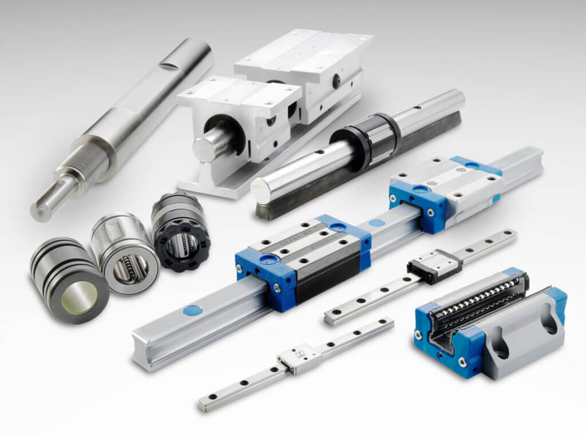
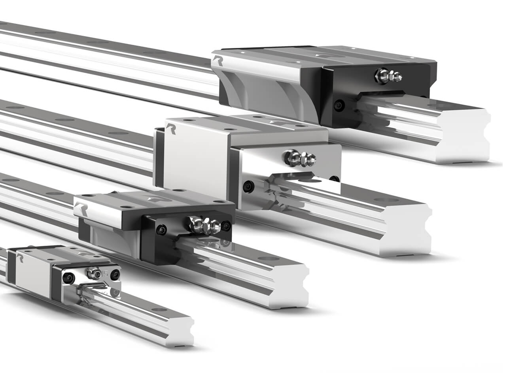
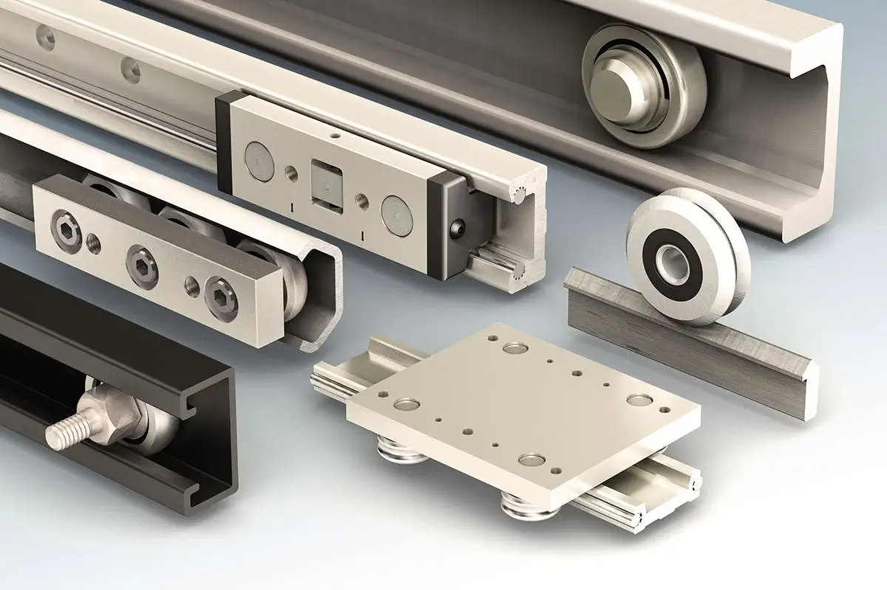
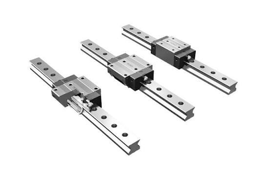
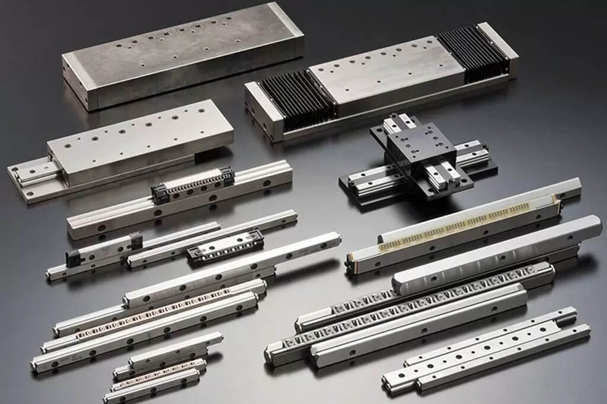
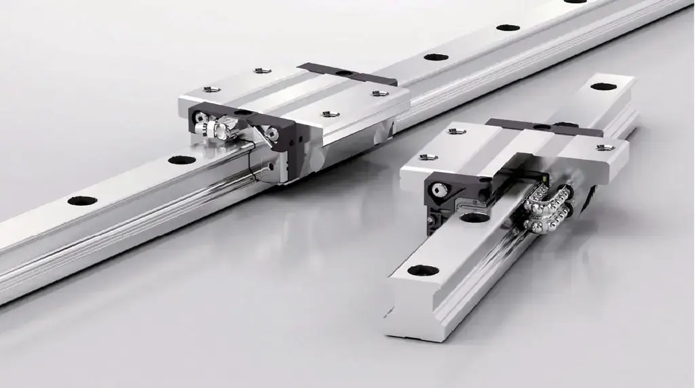
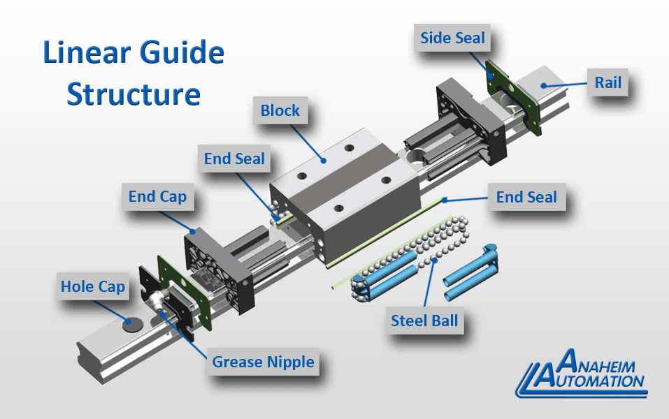
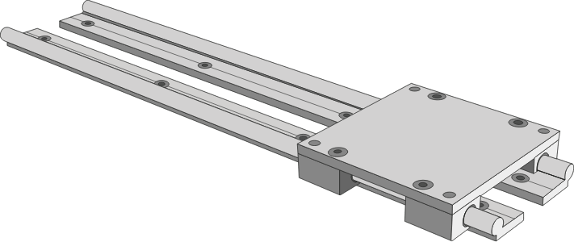
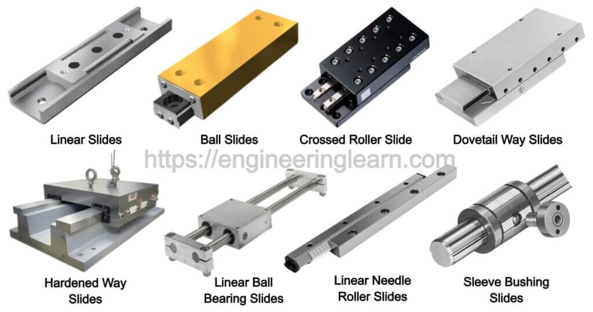
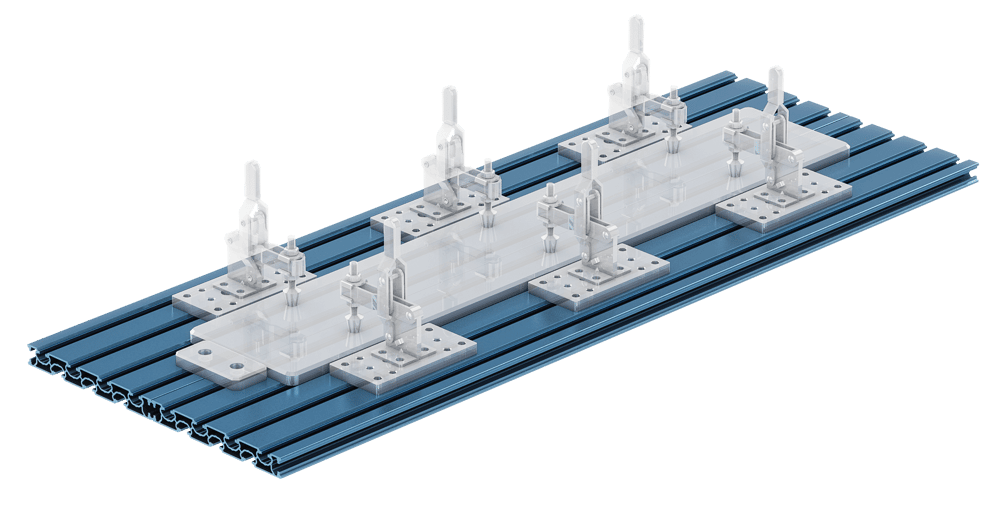

# Linear Slide

[Linear-motion bearing (Wikipedia)](https://en.wikipedia.org/wiki/Linear-motion_bearing)

Gemini on [Linear rail guides](https://share.google/aimode/kL3OJ2CnHMXvgl6Lv)

Linear rail guides (often called linear motion or LM guides) are **mechanical systems that use rolling or sliding elements—such as balls or cylindrical rollers—inside a recirculating carriage (block) to provide smooth, low-friction, and high-precision linear movement along a fixed rail**.

## Main Types of Linear Rail Guides

- **Ball-Type Linear Guides**: Use steel balls providing point contact, high speed, smooth operation, and forgiveness for minor mounting misalignments; commonly used in 3D printers, CNC routers, and general automation.
- **Roller-Type Linear Guides**: Use cylindrical rollers providing line contact, which drastically raises stiffness and load-carrying capacity for heavy-duty CNC machining centers and grinders.
- **Miniature Linear Guides**: Compact versions (often starting at a few millimeters wide) built for small, clean environments like lab automation and medical devices.
- **Plain or Dovetail Slides**: Non-rolling sliding guides that handle heavy shock loads and high friction, often found in specialized machine tool slides.

## Key Components & Characteristics

- **LM Rail**: The hardened, precision-ground steel track that mounts to a machine frame.
- **LM Block (Carriage)**: The moving part that houses recirculating balls or rollers and glides along the rail.
- **Lubrication & Protection**: Requires regular grease or oil plus end seals to keep out dust, chips, and debris.

You can read more about related translation systems on the [Linear stage - Wikipedia](https://en.wikipedia.org/wiki/Linear_stage) and [Linear-motion bearing - Wikipedia](https://en.wikipedia.org/wiki/Linear-motion_bearing) pages.
Are you trying to size a rail for a specific machine (like a CNC or 3D printer) or looking for details on a particular brand/series (like HIWIN or THK)?

---

.jpeg)

