# Slot extrusion

Gemini on [slot extrusion](https://share.google/aimode/jVT2h769p8QBvYz3T)

A **T-slot extrusion** (often called T-slot aluminum framing) is **a modular structural profile made from extruded aluminum (typically 6105-T5 alloy) that features one or more integrated T-shaped grooves**. These channels allow nuts, bolts, and specialized connectors to slide and lock anywhere along the length of the bar without requiring welding.

## Key Features & Types

- **T-Slot vs. V-Slot**: Standard T-slots use flat-bottomed or square-edged channels for general framing and fastening. **V-slot extrusions** feature angled V-grooves designed specifically to act as linear motion tracks for gantry plates and roller wheels (commonly used in 3D printers and CNC machines).
- **Sizing Systems**:
	- **Metric**: Commonly scaled in increments like 20mm, 30mm, 40mm, and 45mm (e.g., 2020, 3030 profiles).
	- **Imperial / Fractional**: Designated by series such as 10 Series (1-inch) and 15 Series (1.5-inch), available from suppliers like [80/20](https://8020.net/) and [McMaster-Carr](https://www.mcmaster.com/).
- Cross-Sections: Usually square or rectangular (such as 1 × 1 inch or 1 × 2 inches), with open slots on one to all four sides.

## Common Applications

- **Machine Guards & Frames**: Industrial enclosures, safety cages, and equipment stands.
- **Workstations & Carts**: Modular assembly tables, tool racks, and office desks.
- **Digital Fabrication & Automation**: Frames and linear motion axes for 3D printers, laser cutters, and CNC routers.

You can design custom builds using web tools like the [80/20 Aluminum Extrusions IdeaBuilder](https://8020.net/) or explore structural load and deflection considerations through guides like [Vention's Design Manual](https://docs.vention.com/docs/designing-with-t-slot-aluminum-extrusions).

Are you planning a specific build (like a **3D printer frame**, **workstation**, or **machine enclosure**), or do you need help calculating the right **profile size** and **fasteners** for a load?

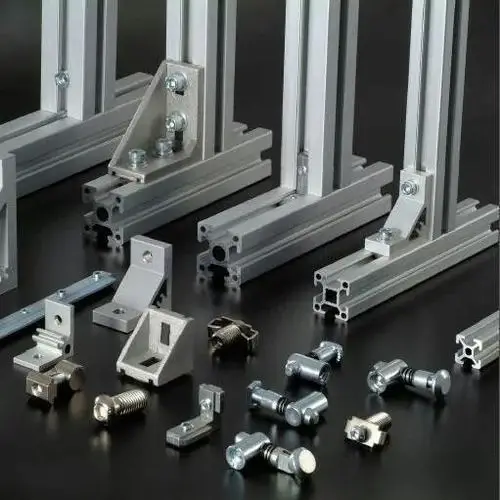

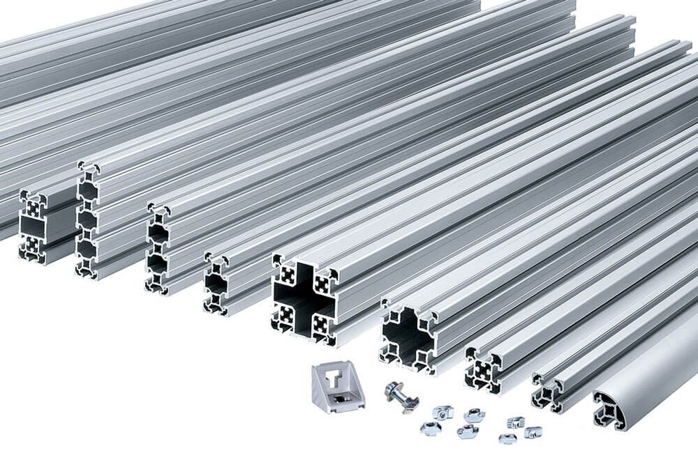

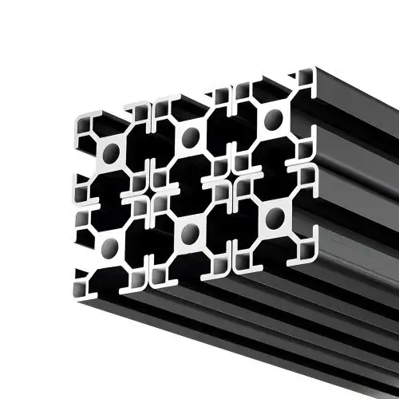

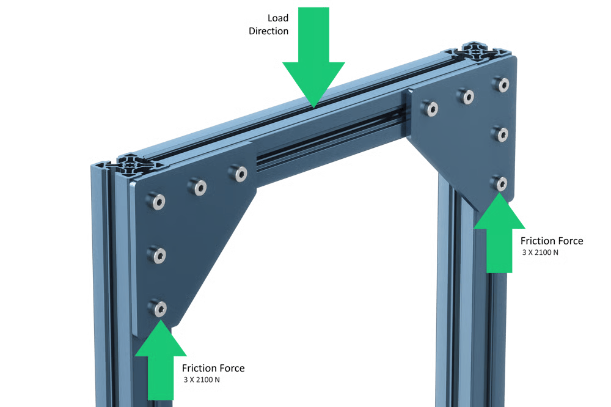

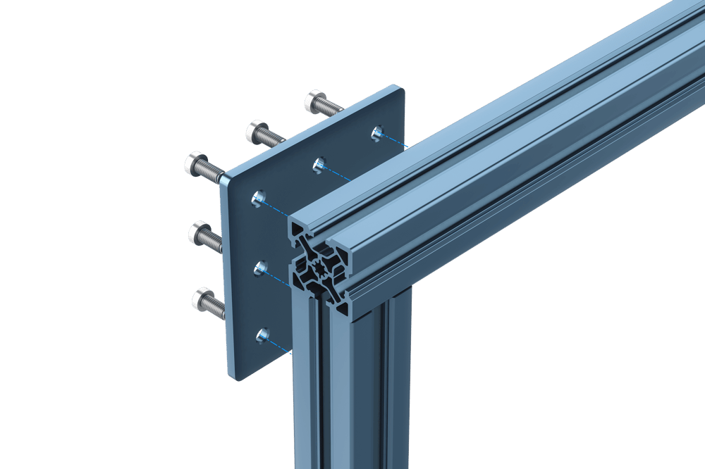

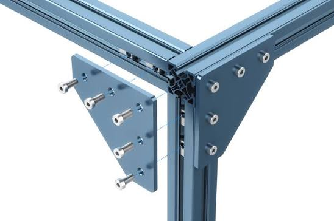

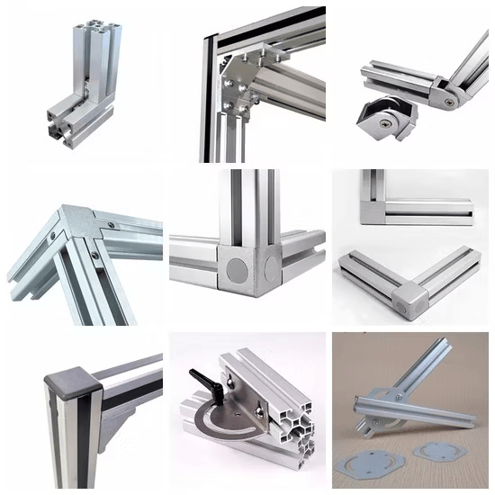

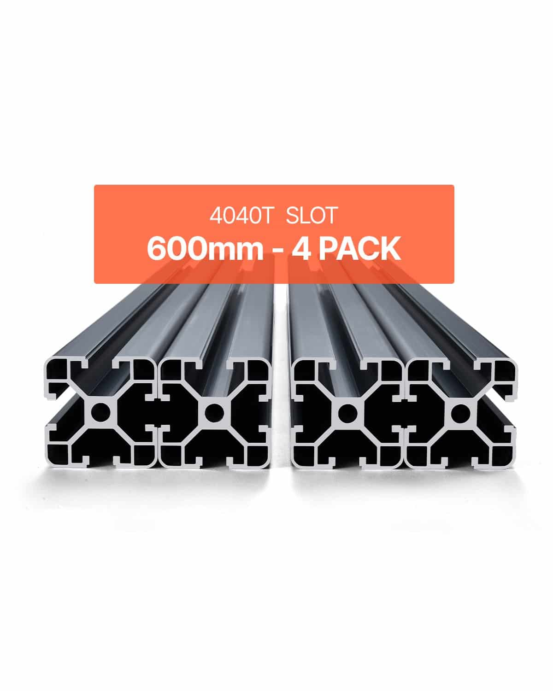

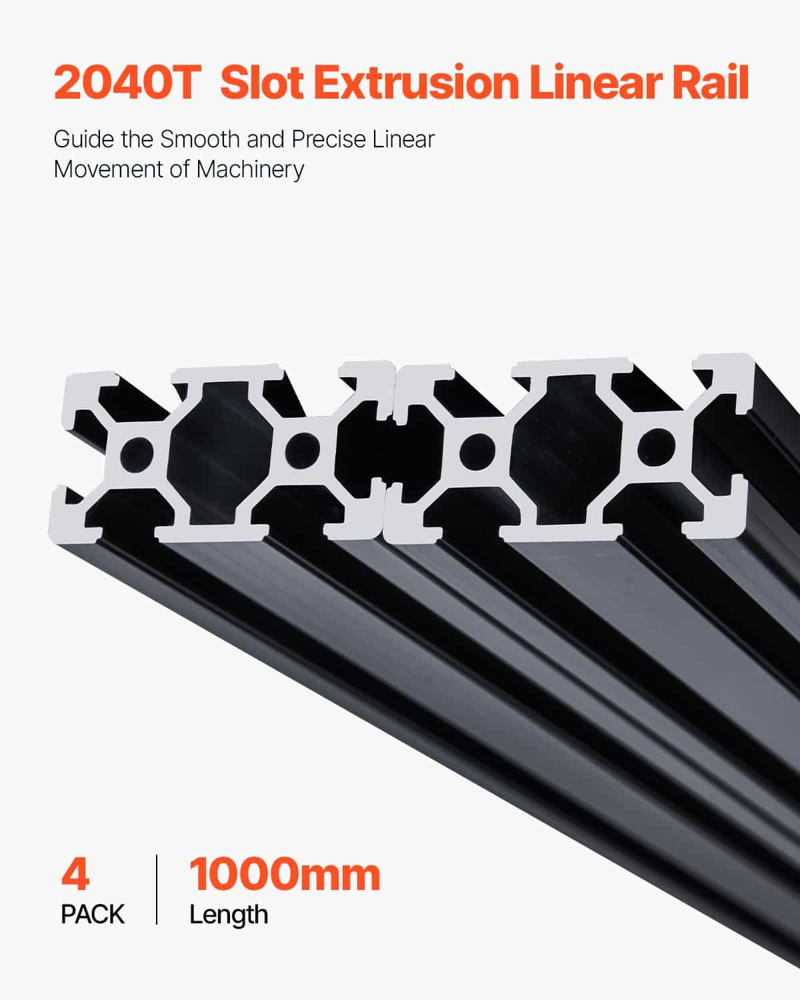

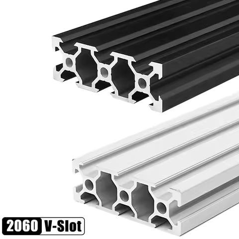

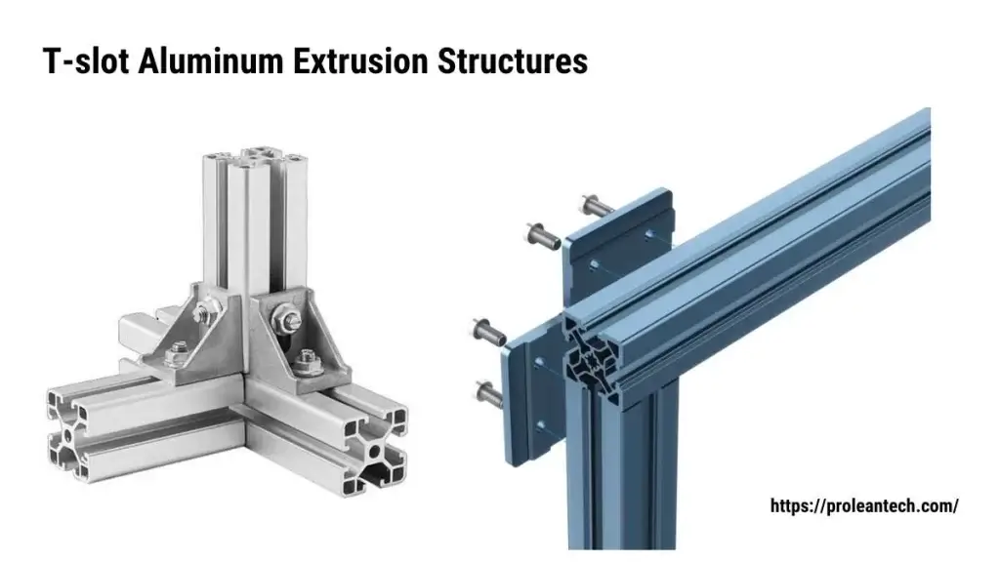

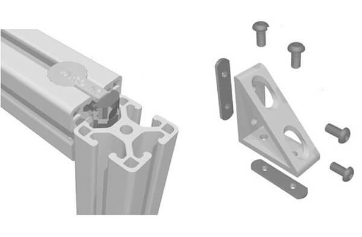

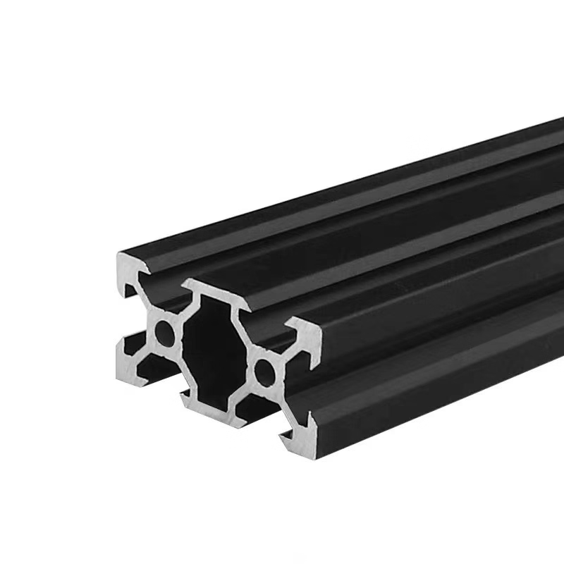

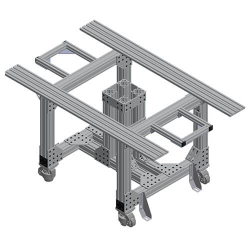

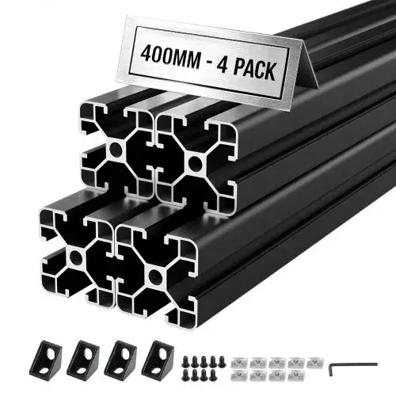

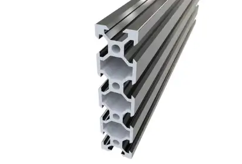

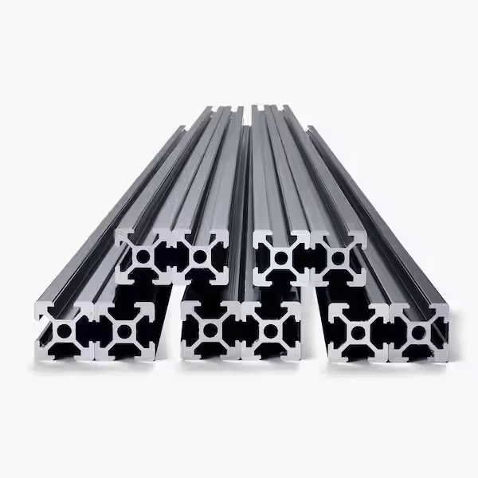

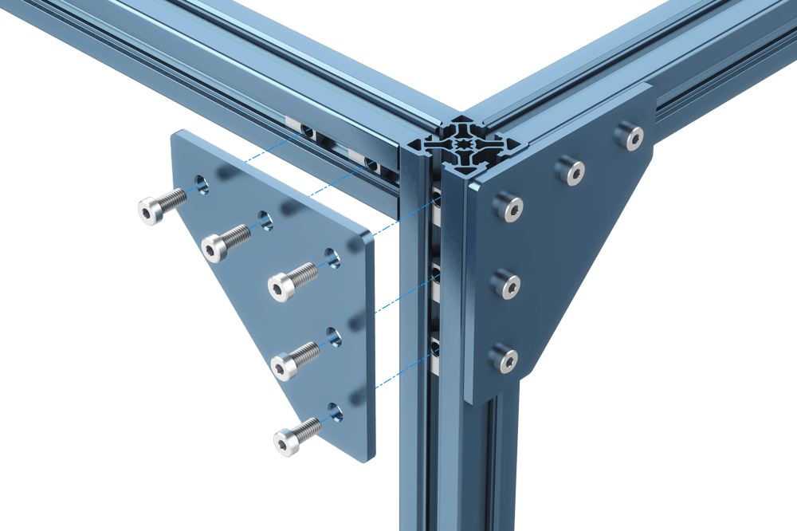

--- 

## C-beam

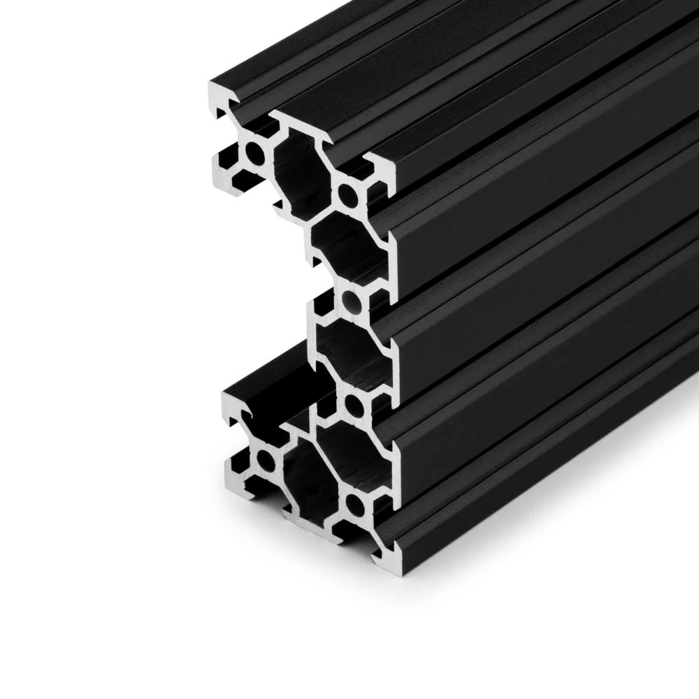

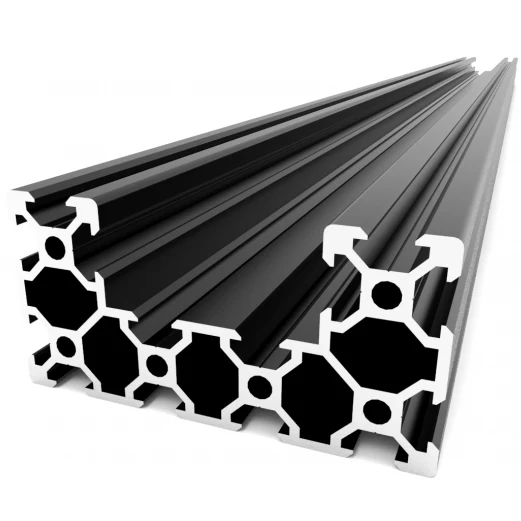

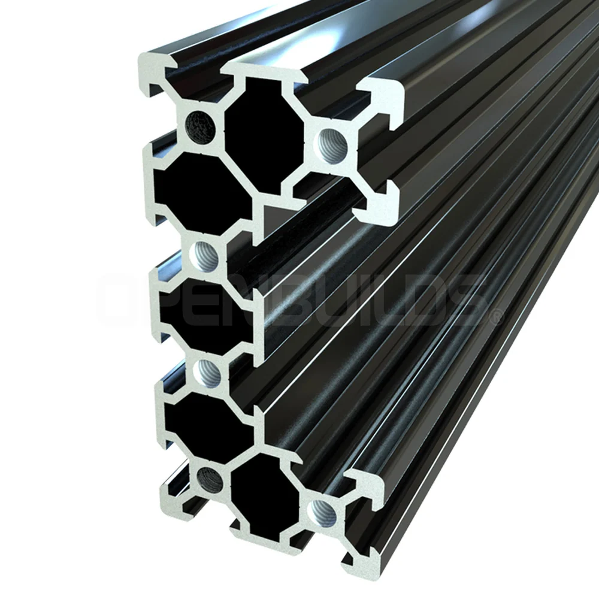
