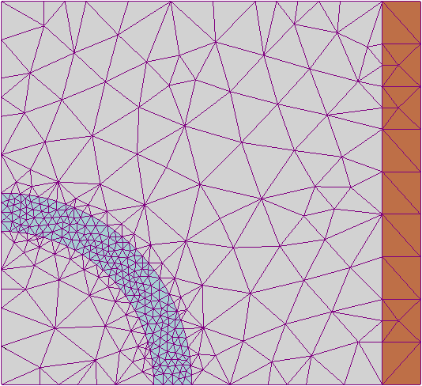
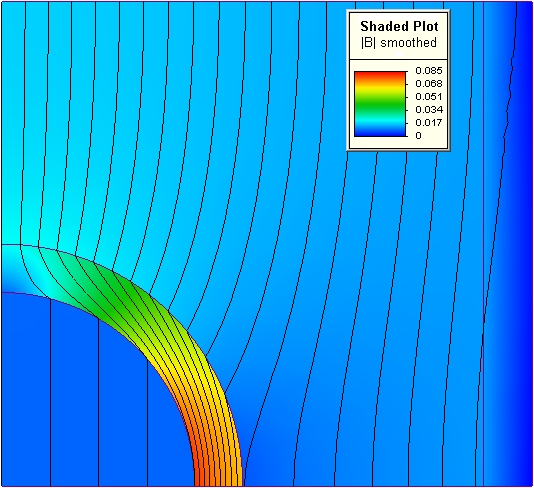

# Finite element method

[Finite element method (FEM) (Wikipedia)](https://en.wikipedia.org/wiki/Finite_element_method) -
is a popular [method](./method.md) for [numerically solving](./numerical-solving.md) [differential equations](./differential-equations.md) arising in engineering and [mathematical modeling](./mathematical-model.md). Typical problem areas of interest include the traditional fields of [structural analysis](./structural-analysis.md), [heat transfer](./heat-transfer.md), [fluid flow (dynamics)](./fluid-dynamics.md), mass transport, and [electromagnetic potential](https://en.wikipedia.org/wiki/Electromagnetic_four-potential). Computers are usually used to perform the calculations required. With high-speed [supercomputers](https://en.wikipedia.org/wiki/Supercomputer), better solutions can be achieved and are often required to solve the largest and most complex problems.

Visualization of how a car deforms in an asymmetrical crash using finite element analysis

FEM is a general [numerical method](./numerical-method.md) for solving [partial differential equations](../mathematics/partial-differential-equation.md) in two- or three-space variables (i.e., some [boundary value problems](./boundary-value-problem.md)). There are also studies about using FEM to solve high-dimensional problems. [1](https://en.wikipedia.org/wiki/Finite_element_method#cite_note-1). To solve a problem, FEM subdivides a large system into smaller, simpler parts called [finite elements](./finite-elements.md). This is achieved by a particular space [discretization](./discretization.md) in the space dimensions, which is implemented by the construction of a [(polygon) mesh](./polygon-mesh.md) of the object: the numerical domain for the solution that has a finite number of points. FEM formulation of a boundary value problem finally results in a system of [algebraic equations](./algebraic-equation.md). The method approximates the unknown function over the domain. [2](https://en.wikipedia.org/wiki/Finite_element_method#cite_note-2). The simple equations that model these finite elements are then assembled into a larger system of equations that models the entire problem. FEM then approximates a solution by minimizing an associated error function via the [calculus of variations](calculus-of-variations.md).

Studying or [analyzing](./analysis.md) a phenomenon with FEM is often referred to as **finite element analysis** (FEA).

## Basic concepts

The subdivision of a whole domain into simpler parts has several advantages:

- Accurate representation of [complex geometry](./complex-geometry.md);
- Inclusion of dissimilar [material properties](./material-properties.md);
- Easy representation of the [total solution](); and
- Capture of [local effects]()

A **typical approach** using the method involves the following steps:

1. Dividing the **domain** of the **problem** into a collection of subdomains, with each **subdomain** represented by a **set of element equations** for the original problem.
2. Systematically **recombining** all **sets of element equations** into a **global system of equations** for the **final calculation**.

### Wikipedia's example of a typical approach

|  |  |
| :--- | :--- |
|  | FEM [mesh](./polygon-mesh.md) created by an analyst before finding a solution to a [magnetic](./magnetism.md) problem using FEM software. Colors indicate that the analyst has set material properties for each zone, in this case, a [conducting](./electrical-conductor.md) wire coil in orange; a [ferromagnetic](./ferromagnetism.md) component (perhaps [iron](../materials/iron.md)) in light blue; and air in grey. Although the geometry may seem simple, it would be very challenging to calculate the magnetic field for this setup without FEM software using [equations alone](./closed-form-expression.md). |
|  | FEM solution to the problem at left, involving a [cylindrically](../geometric-shapes/cylinder.md) shaped [magnetic shield](../electrical-engineering/electromagnetic-shielding.md#Magnetic-shielding). The ferromagnetic cylindrical part shields the area inside the cylinder by diverting the magnetic field [created](../electrical-engineering/electromagnet.md) by the coil (rectangular area on the right). The color represents the [amplitude](../mathematics/norm.md) of the [magnetic flux density](../physics/magnetic-field.md#Definitions), as indicated by the scale in the inset legend, red being high amplitude. The area inside the cylinder is low amplitude (dark blue, with widely spaced lines of magnetic flux), which suggests that the shield is performing as it was designed to. |

### Google Gemini's explanation of Wikipedia's example of a typical approach

| Image & Context | Description & Analysis |
| :--- | :--- |
|  **FEM Mesh Setup** (Before Solution) | An analyst created this 2D mesh before running the simulation. The distinct colors indicate assigned material properties for each specific zone: an orange conducting wire coil, a light blue ferromagnetic component, and grey surrounding air. While the geometry appears simple, calculating the magnetic field for this specific setup using equations alone would be highly challenging. |
|  **FEM Solution** (Simulation Results) | This image displays the final solution for the setup, which features a cylindrically shaped magnetic shield. The ferromagnetic cylinder successfully shields the interior area by diverting the magnetic field generated by the coil (the rectangular area on the right). The colors represent the amplitude of the magnetic flux density—indicated by the inset legend—where red signifies high amplitude and dark blue signifies low amplitude with widely spaced flux lines, confirming the shield is working as designed. |

The global system of equations uses known solution techniques and can be calculated from the [initial values](../mathematics/initial-value-problem.md) of the original problem to obtain a numerical answer.

In the first step above, the element equations are simple equations that locally approximate the original complex equations to be studied, where the original equations are often [partial differential equations (PDEs)](../mathematics/partial-differential-equation.md). To explain the approximation of this process, FEM is commonly introduced as a special case of the [Galerkin method](../mathematics/galerkin-method.md). The process, in mathematical language, is to construct an integral of the [inner product](../mathematics/inner-product-space.md) of the residual and the [weight functions](../mathematics/weight-function.md); then, set the integral to zero. In simple terms, it is a procedure that minimizes the approximation error by fitting trial functions into the PDE. The residual is the error caused by the trial functions, and the weight functions are [polynomial](../mathematics/polynomial.md) approximation functions that project the residual. The process eliminates all the spatial derivatives from the PDE, thus approximating the PDE locally using the following:

- a set of [algebraic equations](../mathematics/algebraic-(polynomial)-equation.md) for [steady-state](../terms-and-definitions/steady-state.md) problems; and
- a set of [ordinary differential equations](../mathematics/ordinary-differential-equation.md) for transient problems.

These equation sets are element equations. They are [linear](../mathematics/linearity.md) if the underlying PDE is linear and vice versa. Algebraic equation sets that arise in the steady-state problems are solved using [numerical linear algebraic](../mathematics/numerical-linear-algebra.md) methods. In contrast, [ordinary differential equation](../mathematics/ordinary-differential-equation.md) sets that occur in the transient problems are solved by numerical integrations using standard techniques such as [Euler's method](../mathematics/euler-method.md) or the [Runge–Kutta methods](../mathematics/runge–kutta-methods.md).

In the second step above, a global system of equations is generated from the element equations by transforming coordinates from the subdomains' local nodes to the domain's global nodes.
This spatial transformation includes appropriate [orientation adjustments](../mathematics/transformation-matrix.md) as applied in relation to the reference [coordinate system](../mathematics/coordinate-system.md). The process is often carried out using FEM software with [coordinate](../mathematics/coordinate-system.md) data generated from the subdomains.

The practical application of FEM is known as finite element analysis (FEA). FEA, as applied in [engineering](../terms-and-definitions/engineering.md), is a computational tool for performing [engineering analysis](../terms-and-definitions/engineering-analysis.md). It includes the use of [mesh generation](../terms-and-definitions/mesh-generation.md) techniques for dividing a [complex problem](../terms-and-definitions/complex-system.md) into smaller elements, as well as the use of software coded with a FEM algorithm. When applying FEA, the complex problem is usually a physical system with the underlying [physics](../physics/physics.md), such as the [Euler–Bernoulli beam equation](../mathematics/euler-method.md), the [heat equation](../mathematics/heat-equation.md), or the [Navier–Stokes equations](../mathematics/navier–stokes-equations.md), expressed in either PDEs or [integral equations](../mathematics/integral-equations.md), while the divided, smaller elements of the complex problem represent different areas in the physical system.

FEA may be used for analyzing problems over complicated domains (e.g., cars and oil pipelines) when the domain changes (e.g., during a solid-state reaction with a moving boundary), when the desired precision varies over the entire domain, or when the solution lacks smoothness.
FEA simulations provide a valuable resource, as they remove multiple instances of creating and testing complex prototypes for various high-fidelity situations. For example, in a frontal crash simulation, it is possible to increase prediction accuracy in important areas, like the front of the car, and reduce it in the rear of the car, thus reducing the cost of the simulation.

---
???
---

Another example would be in [numerical weather prediction](../terms-and-definitions/numerical-weather-prediction.md), where it is more important to have accurate predictions over developing highly nonlinear phenomena, such as tropical cyclones in the atmosphere or eddies in the ocean, rather than relatively calm areas.

---
???
---

A clear, detailed, and practical presentation of this approach can be found in the textbook The Finite Element Method for Engineers.
