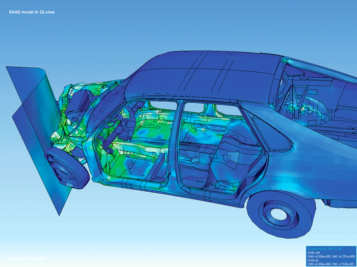

# Finite element method

[Finite element method (FEM) (Wikipedia)](https://en.wikipedia.org/wiki/Finite_element_method) -
is a popular [method](./method.md) for [numerically solving](./numerical-solving.md) [differential equations](./differential-equations.md) arising in engineering and [mathematical modeling](./mathematical-model.md). Typical problem areas of interest include the traditional fields of [structural analysis](./structural-analysis.md), [heat transfer](./heat-transfer.md), [fluid flow (dynamics)](./fluid-dynamics.md), mass transport, and [electromagnetic potential](https://en.wikipedia.org/wiki/Electromagnetic_four-potential). Computers are usually used to perform the calculations required. With high-speed [supercomputers](https://en.wikipedia.org/wiki/Supercomputer), better solutions can be achieved and are often required to solve the largest and most complex problems.

Visualization of how a car deforms in an asymmetrical crash using finite element analysis

FEM is a general [numerical method](./numerical-method.md) for solving [partial differential equations](./partial-differential-equation.md) in two- or three-space variables (i.e., some [boundary value problems](./boundary-value-problem.md)). There are also studies about using FEM to solve high-dimensional problems. [1](https://en.wikipedia.org/wiki/Finite_element_method#cite_note-1). To solve a problem, FEM subdivides a large system into smaller, simpler parts called [finite elements](./finite-elements.md). This is achieved by a particular space [discretization](./discretization.md) in the space dimensions, which is implemented by the construction of a [(polygon) mesh](./polygon-mesh.md) of the object: the numerical domain for the solution that has a finite number of points. FEM formulation of a boundary value problem finally results in a system of [algebraic equations](./algebraic-equation.md). The method approximates the unknown function over the domain. [2](https://en.wikipedia.org/wiki/Finite_element_method#cite_note-2). The simple equations that model these finite elements are then assembled into a larger system of equations that models the entire problem. FEM then approximates a solution by minimizing an associated error function via the [calculus of variations](calculus-of-variations.md).

Studying or [analyzing](./analysis.md) a phenomenon with FEM is often referred to as **finite element analysis** (FEA).
