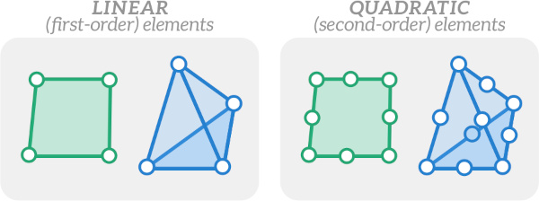
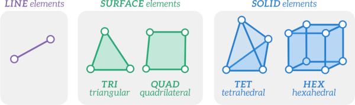
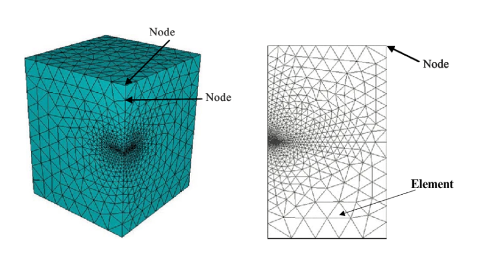
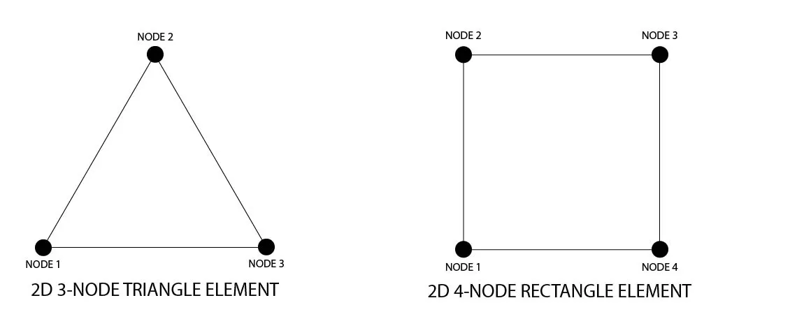

https://enterfea.com/what-are-the-types-of-elements-used-in-fea/

https://efficientengineer.com/finite-element-method/

https://sdcverifier.com/structural-engineering-101/what-are-element-and-node-sets-in-fea-2/

https://sdcverifier.com/articles/rbe2-vs-rbe3/

https://www.mathworks.com/discovery/finite-element-analysis.html

