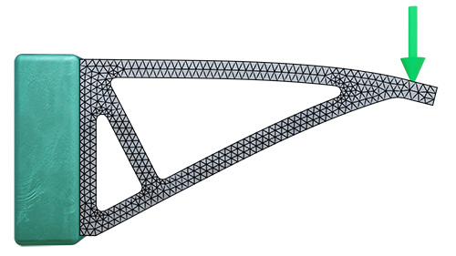

---

## mesh or polygon mesh in fea

[google: mesh or polygon mesh in fea](https://www.google.com/search?q=mesh+or+polygon+mesh+in+fea&oq=mesh+or+polygon+mesh+in+fea&gs_lcrp=EgZjaHJvbWUyBggAEEUYOTIHCAEQABjvBTIHCAIQABjvBTIHCAMQABjvBdIBCDM0MjBqMGo3qAIAsAIA&sourceid=chrome&source=chrome.ob&ie=UTF-8)

- An **FEA mesh** is a mathematical discretization of a continuous engineering domain into finite elements and nodes
- whereas a **polygon mesh** is a visual or computer-graphics surface representation made of connected polygons (like triangles or quads) used primarily in 3D modeling, gaming, and rendering

[Meshing in FEA, CFD and manufacturing (ntop)](https://www.ntop.com/resources/blog/meshing-in-fea-cfd-manufacturing/)

[FEA Mesh Explained: For Absolute Beginners - Part 1 | Learn with BK](https://www.youtube.com/watch?v=6UOEKSO0iJM)

[FEA Mesh Explained Part 2 | 3D Solid Mesh, Tet Mesh, Hex Mesh & Mesh Quality](https://www.youtube.com/watch?v=87o-yIHjYLU)

### FEA Mesh vs. Polygon Mesh

| Feature | FEA Mesh (Finite Element Analysis) | Polygon Mesh (Computer Graphics / CAD Art) |
| :--- | :--- | :--- |
| **Primary Purpose** | Solving physical governing equations (stress, heat transfer, fluid flow). | Visual representation, rendering, animation, or game assets. |
| **Underlying Math** | Contains physical properties (material data, thickness, stiffness, volume/mass) inside elements and nodes. | Focuses on surface normals, UV mapping, textures, and visual shading. |
| **Element Types** | 1D beams, 2D shells/membranes, and 3D volume elements (tetrahedra, hexahedra/bricks). | Typically triangle or quad polygon faces defining an outer skin. |
| **Quality Requirements** | Strict geometric and numerical criteria (aspect ratio, skewness, Jacobian) to prevent solver failure or inaccuracy. | Tolerates warped or irregular polygons as long as the visual appearance looks smooth. |
| **Interior Volume** | Must handle true volumetric solid meshes or exact shell formulations for structural mechanics. | Usually hollow outer shells (surface-only representation). |

### Why You Cannot Use a Raw Polygon Mesh in FEA

1. **Lack of Volumetric / Physical Data**: Graphics or gaming polygon meshes are skin-deep (surface shells) and lack proper internal volume continuity, material orientation, or manifold integrity needed for load transfer. [Meshing in FEA, CFD and manufacturing (ntop)](https://www.ntop.com/resources/blog/meshing-in-fea-cfd-manufacturing/)
2. **Poor Element Quality**: Polygon meshes often have extreme aspect ratios, overlapping faces, or non-manifold geometry that cause FEA stiffness matrices to become singular or fail numerical convergence. [The Fundamentals of FEA Meshing for Structural Analysis](https://ansys.synopsys.com/blog/fundamentals-of-fea-meshing-for-structural-analysis)
3. **Defeaturing and Preparation**: Moving a CAD or art model into FEA requires defeaturing (stripping out logos, fillets, or visual noise) and rebuilding the domain into well-conditioned tetrahedral or hexahedral elements. [The Fundamentals of Mesh Generation in Finite Element Analysis](https://www.fea-academy.com/pdf/fea-academy-the-fundamentals-of-mesh-generation-in-finite-element-analysis.pdf), [The Fundamentals of FEA Meshing for Structural Analysis](https://ansys.synopsys.com/blog/fundamentals-of-fea-meshing-for-structural-analysis)

You can read more about preprocessing best practices via the [SimScale Mesh Guide](https://www.simscale.com/docs/simwiki/preprocessing/what-is-a-mesh/) or review element foundations in [The Fundamentals of Mesh Generation in Finite Element Analysis](https://www.fea-academy.com/pdf/fea-academy-the-fundamentals-of-mesh-generation-in-finite-element-analysis.pdf).

Are you trying to [convert a 3D model or CAD file into an FEA mesh](https://www.google.com/search?q=mesh+or+polygon+mesh+in+fea&oq=mesh+or+polygon+mesh+in+fea&gs_lcrp=EgZjaHJvbWUyBggAEEUYOTIHCAEQABjvBTIHCAIQABjvBTIHCAMQABjvBdIBCDM0MjBqMGo3qAIAsAIA&sourceid=chrome&source=chrome.ob&ie=UTF-8#:~:text=Are%20you%20trying%20to%20convert%20a%203D%20model%20or%20CAD%20file%20into%20an%20FEA%20mesh%20for%20a%20specific%20simulation%20project%2C%20or%20troubleshooting%20a%20mesh%20quality%20error%20in%20your%20software%3F) for a specific simulation project, or troubleshooting a [mesh quality error](https://www.google.com/search?q=mesh+or+polygon+mesh+in+fea&oq=mesh+or+polygon+mesh+in+fea&gs_lcrp=EgZjaHJvbWUyBggAEEUYOTIHCAEQABjvBTIHCAIQABjvBTIHCAMQABjvBdIBCDM0MjBqMGo3qAIAsAIA&sourceid=chrome&source=chrome.ob&ie=UTF-8#:~:text=troubleshooting%20a%20mesh-,quality,-error%20in%20your) in your software?

----

[Meshing in FEA: Element Types, Quality Criteria & Best ...](https://sdcverifier.com/structural-engineering-101/meshing-in-finite-element-analysis/)
