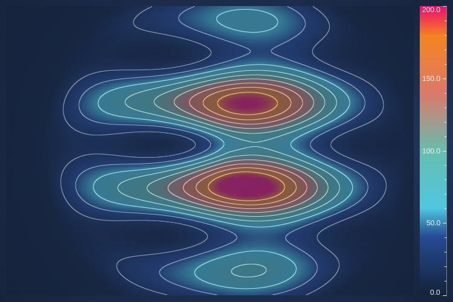
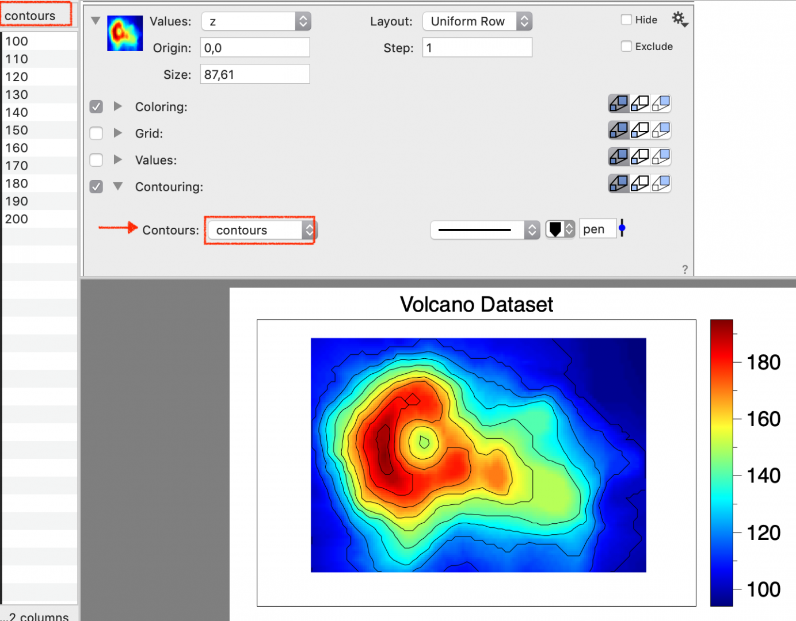
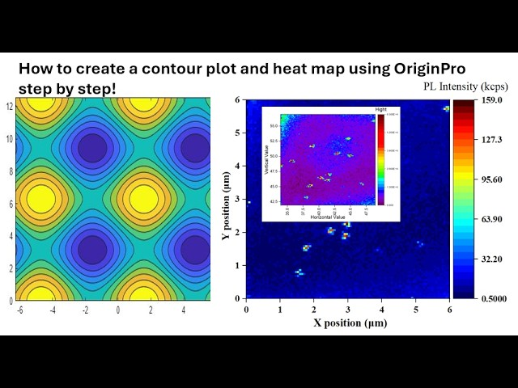

# Dynamic Contour Heatmaps

[Dynamic Contour Heatmaps (Google)](https://www.google.com/search?sca_esv=f6888a27e4d63945&sxsrf=AKL5yDhrWmBqwMIdQ8giJOjXpGV6REPuQQ:1794336163044&udm=2&fbs=ACAhTvwdifjn2dKXmjtOfBxVFl_koHVe5RLSnJlTH2QYaq_YVdLmrLcUHX_SwxOCJnubtIIfkFBtNyvuNluxGIMJwZYVMqv6rIn83-ZO10wQYTBLYugpE5sK1JUmaUaeoBOxkAdsyPFIYGYUcpxWy_b73XjeG32__CE_gf4V9FZyUBrEpgJInh3poxO-IXPard5eunasD_M0JyVv_qpAWlloIZTIZTJvbQ&q=Dynamic+Contour+Heatmaps&sa=X&ved=2ahUKEwjd_OuMh_6XAxW32AIHHY1IEgQQtKgLegQIGxAB)

process conversation with Gemini on [Dynamic Contour Heatmaps](https://share.google/aimode/OtpoB59Bu4BAiPWlG)

...

---

process conversation with Gemini on [Dynamic Contour Heatmaps (2)](https://share.google/aimode/tsA2trZtm7PGhqVFP)

**Dynamic contour heatmaps** combine two powerful data visualization techniques—heatmaps (which use a continuous color spectrum to represent value density across a 2D grid) and contour lines (isolines that connect points of equal value, similar to a topographic map)—and animate them to reflect real-time or time-series changes.

They are highly utilized in processing streaming spatiotemporal data (such as urban traffic patterns, real-time weather monitoring, and medical imaging tracking) where data values across coordinates constantly shift over time.

## 🛠️ Core Visual Elements

- **The Heatmap Base Layer**: Maps continuous variations across an X and Y Cartesian grid using a gradient palette (e.g., Viridis or Magma) where color intensity natively indicates density or scalar magnitude.
- **The Isoline Overlay**: Sharp, distinct contour lines drawn at designated thresholds (e.g., every 5 units) to give structural and quantitative boundaries to the soft gradients of the heatmap.
- **The Temporal Dimension (Dynamic Aspect)**: Utilizes a play bar, animation loop, or real-time data stream socket to update data dimensions instantly, causing the shapes of both the heatmap gradients and the isolines to morph organically over time.

## 📈 Technical Implementations

Depending on your workflow, dynamic contour maps can be implemented across different ecosystems:

### 1. Web & JavaScript (High Performance)

For production-grade real-time web applications, rendering thousands of updating points requires GPU acceleration.

- **SciChart.js**: Widely recognized for high-performance dashboards, it provides specific components (UniformHeatmapRenderableSeries combined with UniformContoursRenderableSeries) powered by WebGL to seamlessly pan, zoom, and transition smooth colors under morphing isolines in modern frameworks like React.

### 2. Python Ecosystem (Data Science & Analytics)

Python provides robust scripting alternatives for structural modeling and generating standalone spatial animations:

- **Matplotlib & Plotly**: Combining `contourf()` (filled contour heatmap) with `contour()` (isolines) inside a `matplotlib.animation.FuncAnimation` loop allows you to output dynamic video or GIF files. Plotly provides an native out-of-the-box `frame` parameter for spatial time-series tracking.

### 3. Standard Business Apps (No-Code/Low-Code)

- **Microsoft Excel**: Using the native **3D Maps** tool under the Insert tab, you can input location parameters (Latitude/Longitude) alongside a chronological timestamp. Swapping the visualization type to a **Heat Map** and attaching a time-series field auto-generates a dynamic, playable animation slider showcasing hot spots shifting across time frames.

Are you looking to implement a dynamic contour heatmap for a **specific application** (e.g., weather data, web app, geographic tracking), or do you need help writing the **Python/JavaScript code** to build one?

---

**Dynamic contour heatmaps** are **advanced 2D data visualizations that merge continuous, color-coded magnitude grids (heatmaps) with threshold boundary lines (contours) to map spatiotemporal changes over time**. While a standard heatmap visualizes density or intensity values through varying color gradients, adding dynamic contours provides distinct mathematical boundaries that shift seamlessly as underlying real-time data streams fluctuate.

[Scichart: React Heatmap Chart With Contours Example](https://www.scichart.com/demo/react/heatmap-chart-with-contours)

[Heat map (Wikipedia)](https://en.wikipedia.org/wiki/Heat_map)

[Data Visualization](https://acme.byu.edu/0000017a-1bb8-db63-a97e-7bfa0bf00000/vol1lab11data-pdf)

[How to draw Contour Lines in DataGraph](https://www.youtube.com/watch?v=r7YttbVGoRE)

[Dynamic heatmap pyramid computation for massive high-parallel spatial streaming in urban environments](https://www.tandfonline.com/doi/full/10.1080/17538947.2024.2368099#d1e2351)

## 🛠️ Key Architectural Elements

- **The Heatmap Matrix**: Represents continuous 3D scalar data (X, Y coordinates mapping to a Z value) mapped onto a 2D color gradient. Perceptually uniform color palettes like Viridis or Magma are heavily utilized to prevent visual continuity errors common in legacy rainbow spectrums.
- **The Contour Overlay**: Draws isolines (or iso-surfaces) that connect identical scalar values. These act as instant visual quantifiers, making it easy to isolate explicit thresholds (e.g., elevation, concentration, or temperature levels) at a glance.
- **The Temporal Dimension (Dynamic)**: Infuses time-series sequences or real-time streaming pipelines. As values update, the heatmap cells transition smoothly and the contour lines dynamically warp, contract, expand, or split to mirror structural structural shifts in data.

## 💻 Industry Applications & Technical Core

- **Meteorology & Environmental Science**: Tracking moving pressure fronts, localized precipitation variations, or shifting temperature zones over time.
- **Geospatial & Urban Streaming**: Real-time visualization of city-wide traffic densities, ride-share demand spikes, and human mobility patterns leveraging big data stream frameworks like Apache Flink.
- **Biomedical Engineering**: Tracking cellular change, mapping neural activity fields, or calculating subclinical margins during specialized real-time surgical imaging.
- **Web/App Engine Implementation**: Developed natively using libraries like SciChart.js (built for high-speed WebGL hardware acceleration), Python's matplotlib/seaborn configurations, or interactive JavaScript visualization tools like Plotly.

What aspect of dynamic contour heatmaps are you focusing on today? If you like, I can provide:
- A complete, ready-to-run **Python script** (using NumPy and Matplotlib) to generate an animated contour heatmap.
- Performance optimization methods for handling large **streaming datasets**.
- UI design guidelines for choosing **accessible color maps** and configuring step intervals.
