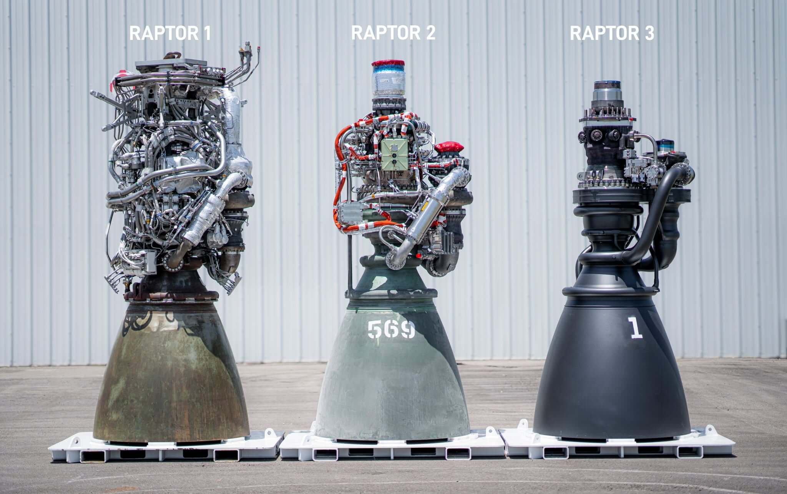
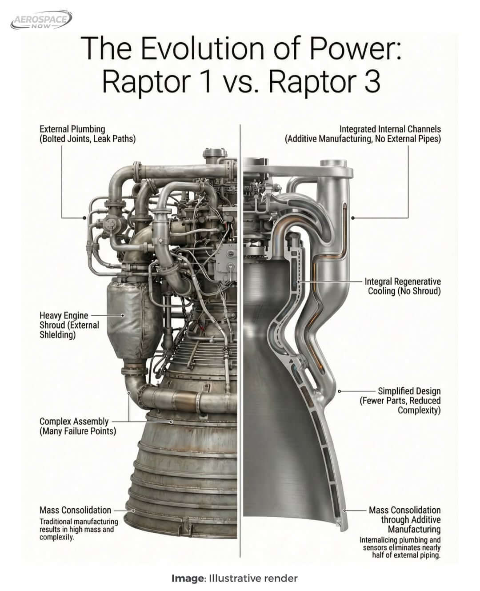
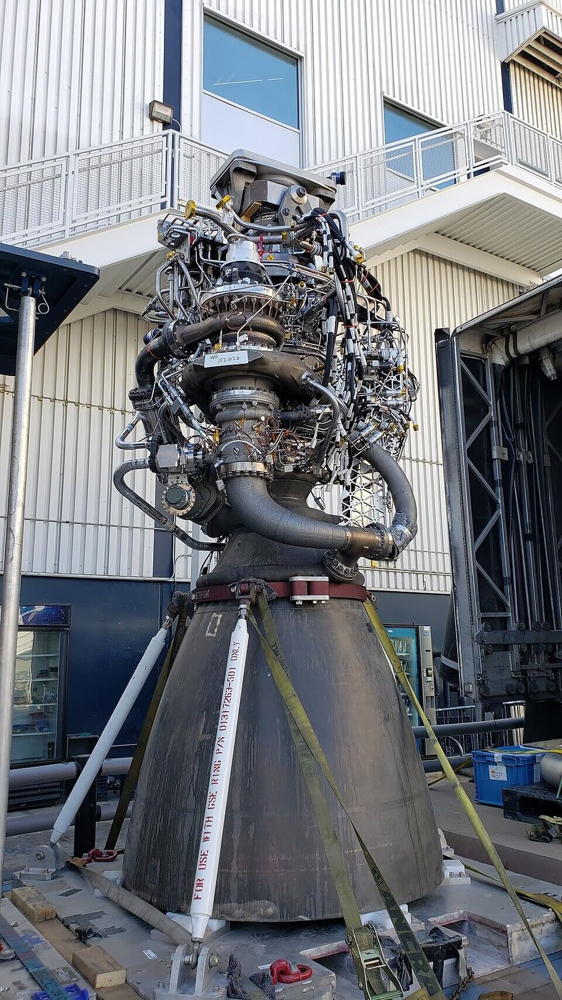
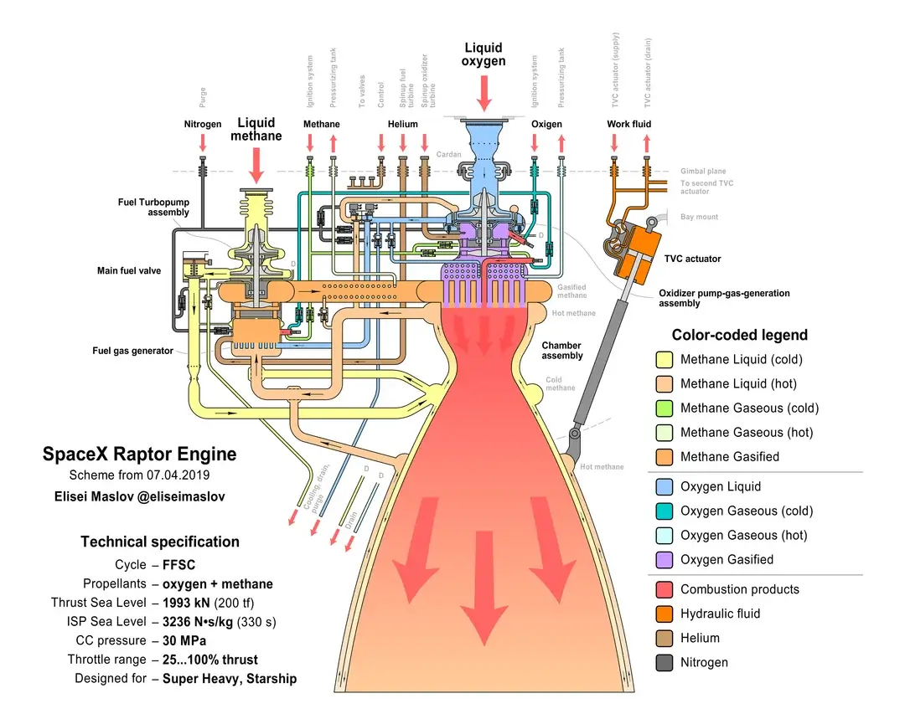
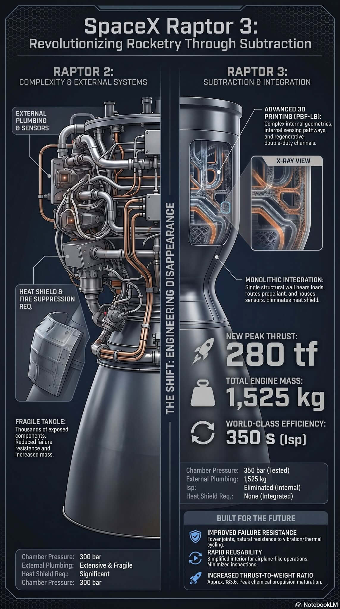
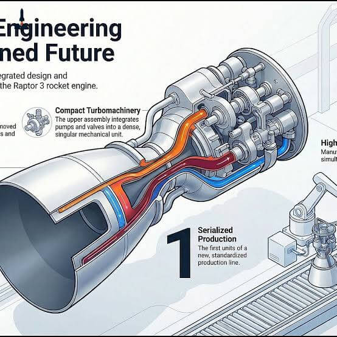
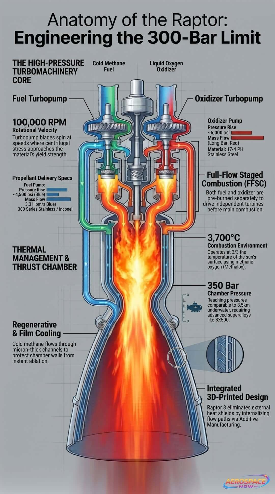
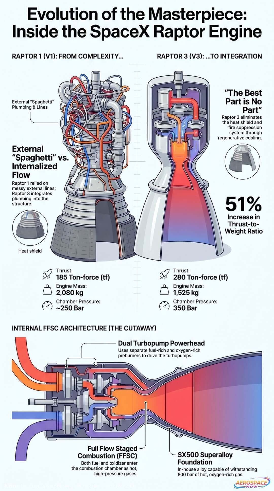

# Structural components

From conversation with Gemini on [List of all structural components of Raptor 3 engine](https://share.google/aimode/04XmRvUFaZHewhEVF)

The [SpaceX Raptor 3](https://en.wikipedia.org/wiki/SpaceX_Raptor) relies on a streamlined, highly integrated architecture where [metal additive manufacturing](https://www.voxelmatters.com/elon-musk-confirms-new-raptor-3-optimization-was-made-possible-by-am/) fuses secondary plumbing, sensors, and cooling channels directly into the engine's primary load-bearing structures.

[Why SpaceX Replaced Manual Wiring With Structural Data Busses In Raptor Three](https://www.facebook.com/61576590631957/videos/why-spacex-replaced-manual-wiring-with-structural-data-busses-in-raptor-three-sp/1937723883530909/) (Facebook)

[🔥 How SpaceX removed the engine heat shield on Raptor 3 🚀](https://www.instagram.com/p/Dfm0Y5jEhC2/)

## 1. Turbomachinery & Pre-Burner Assemblies

Raptor 3 maintains the signature full-flow staged combustion layout with two distinct turbopump assemblies:

- **Oxidizer Turbopump Assembly (Top-Mounted)**. Positioned axially at the top of the engine, housing the liquid oxygen (LOX) pump impeller, oxygen-rich turbine, and oxygen-rich pre-burner. Constructed from SpaceX's proprietary SX500 superalloy to resist hot, corrosive oxygen-rich gas.
  - [SpaceX Starship (Wikipedia)](https://en.wikipedia.org/wiki/SpaceX_Starship)
  - [How SpaceX Streamlined the Raptor Engine](https://www.construction-physics.com/p/how-spacex-streamlined-the-raptor)
  - [Inside the SpaceX Raptor 3 Engine](https://www.youtube.com/watch?v=ekITLCGMC4E)

- **Fuel Turbopump Assembly (Side-Mounted)**. Mounted parallel to the main chamber axis, containing the liquid methane (CH₄) pump impeller, fuel-rich turbine, and fuel-rich pre-burner.
  - [How SpaceX Reinvented The Raptor 3 Rocket Engine!](https://www.youtube.com/watch?v=CrzvM7WT4ZE)

- **Hydrostatic Bearings**. Fluid-film bearings integrated into the turbopump housings that float the rotating shafts on a high-pressure cushion of cryogenic propellant tapped directly from the pump discharge.
  - [The Hidden Technology That Makes SpaceX's Raptor 3 Possible](https://www.youtube.com/watch?v=_meDQry3sf8&t=127s)

## 2. Combustion & Thrust Chamber Assembly

- **Hot Gas Manifold & Main Injector**. Situated immediately beneath the turbopumps, this structural casting merges the oxygen-rich and fuel-rich gaseous exhausts and feeds them into coaxial swirl injectors at the top of the chamber.
  - [Raptor Engine (Starship SpaceX Wiki)](https://starship-spacex.fandom.com/wiki/Raptor_Engine)
- **Main Combustion Chamber (MCC) & Throat**. A copper-alloy inner liner with milled regenerative cooling channels, backed by a high-strength structural jacket engineered to contain 350 bar of chamber pressure.
- **Regeneratively Cooled Nozzle**. A bell-shaped steel nozzle (or an extended brazed-tube nozzle on the RVac variant) featuring internal cooling passages that circulate subcooled methane to absorb exhaust heat.

## 3. Integrated Fluid & Control Hardware

Unlike Raptor 1 and 2, Raptor 3 embeds its auxiliary systems inside the structural walls rather than bolting them externally:

- **Internalized Propellant & Secondary Conduits**. Main propellant transfer lines, bleed lines, and purge passages are printed or machined directly inside the structural housings, replacing external pipes and bolted flanges with continuous welds.
- **Embedded Main Valves**. Primary fuel and oxidizer control valves are integrated directly into the engine's structural manifolds and cooled by circulating cryogenic fuel.
- **Torch Igniters**. Internalized ignition systems for the pre-burners; external main-chamber spark igniters were eliminated.
- **Armored Avionics & Sensor Channels**. Flight computers, pressure/temperature sensors, and wiring harnesses are routed inside regeneratively cooled structural cavities, eliminating the need for individual engine heat shields.

## 4. Mounting & Gimbal Hardware

- **Gimbal Mount & Thrust Structure Interface**. The upper structural yoke that transfers up to 280 metric tons of thrust directly into the Starship or Super Heavy thrust puck.
- **Electric Thrust Vector Control (TVC) Actuators**. Electromechanical actuators attached to the chamber/gimbal structure (on the inner 13 booster engines and upper-stage engines) providing up to 15° of gimbaling range.

Would you like a breakdown of:
- The **materials and alloys** used in each section (such as SX500 and copper liners)
- How the **propellant flow path** moves through these components during startup and steady-state operation?

