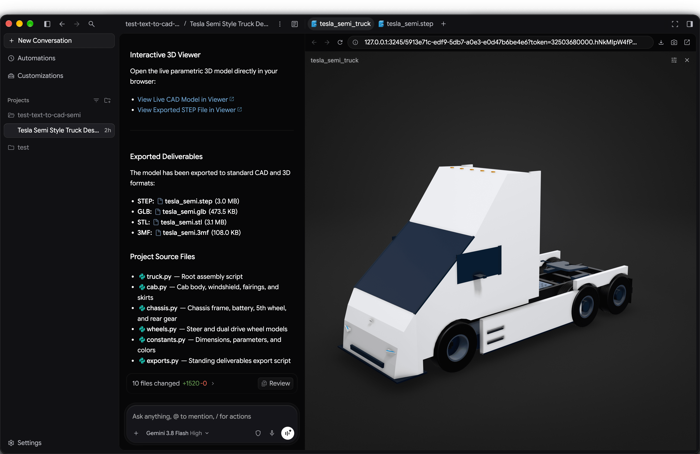

# Considerations based on Semi Truck CAD Design

Based on the generated [Tesla Semi CAD Designs](../../../CAD-models/test-text-to-cad-semi) ([screenshots](CAD-models/test-text-to-cad-semi-img/test-text-to-cad-semi-img.md)), it looks like:

1. We have a proven possibility to [generate CAD designs](ideas/techstack/text-to-cad/text-to-cad.md) with AI agents and skills 
2. The generated CAD design (particularly with text-to-cad) is made **without curved surfaces**) ([see Prompt 5 of text-to-cad-evolution-path-for-integrated-product-design.md](ideas/production/production-methodology/integrated-products/text-to-cad-evolution-path-for-integrated-product-design.md))
3. In order to fix it, we might have to either:
    1. Look for text-to-cad alternatives that do CAD designs with curved surfaces out of the box
    2. Try to integrate text-to-cad with a geometry kernel that will suffice for curved surfaces (such that we get a beautiful product CAD design)

4. We might need to iterate on text-to-cad (and possibly / probably other tools) on the described evolution path until we get a possibility to design not just abstract products, but integrated products (assuming component graph tree) and components (they are made of)

5. We might need to iterate (on every component) on the generation capabilities throughout the toolset (from models, to agents, skills, etc.) for every component until we get a high-quality integrated product and components design

6. Once done with point 5., we might have to iterate on open-source manufacturing tooling that would allow to manufacture high-quality components for assembly of the integrated product with given tech specs in an automated way (AI agents + skills)
