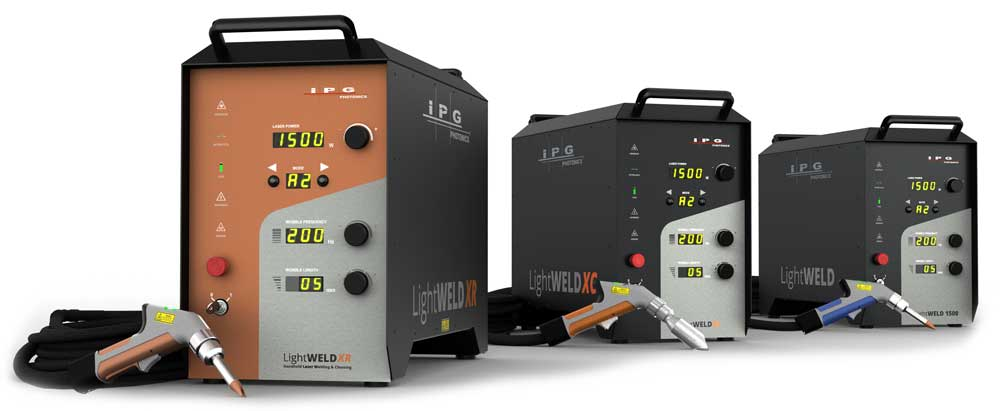
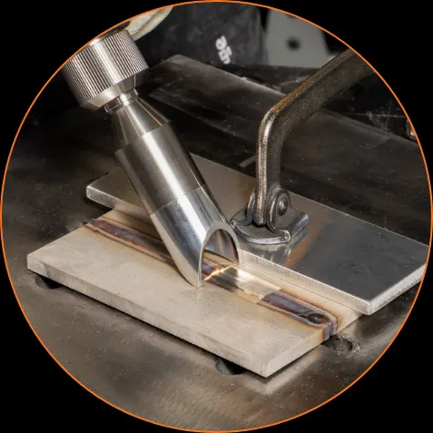
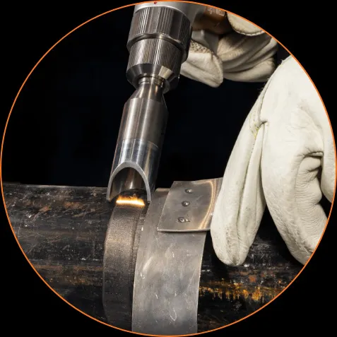
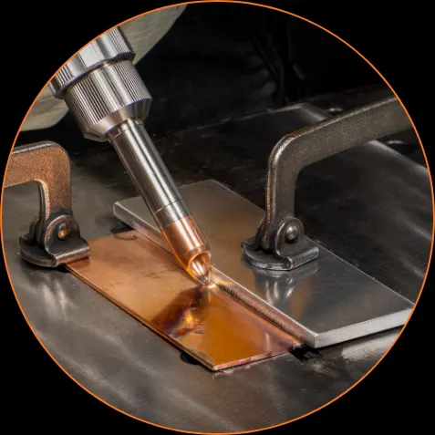
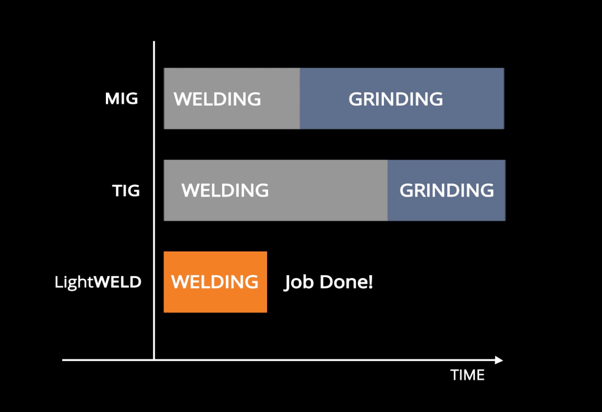

# Photonic welding

## Part 1

From conversation with Gemini on [does lightweld use arc welding?](https://share.google/aimode/CNr6fLp07frzgknKV)

> does lightweld (https://www.lightweld.com/) use arc welding?

No, LightWELD does not use arc welding—it is a **handheld fiber laser welding system**.

[lightweld.com](https://www.lightweld.com/)

[Handheld Laser Welding System (Laser Welding & Cleaning)](https://www.lightweld.com/handheld-laser-welder/)

[Laser Welding Basics](https://www.lightweld.com/the-weld-shop/laser-welding-basics/)

Rather than relying on an electrical arc, the [LightWELD system](https://www.lightweld.com/handheld-laser-welder/) uses a focused beam of light (photons) to melt and join metal:

[Laser Welding vs Arc Welding: Key Differences and Advantages Explained | IPG Photonics | Facebook](https://www.facebook.com/IPGPhotonics/videos/what-is-laser-welding/1194428371640279/)

- **No electricity or electrode**. Unlike MIG or TIG welding, there is no electrode and no electrical current passing through the part. [MIG & TIG vs. Laser Welding: Advantages & Differences](https://www.lightweld.com/the-weld-shop/mig-tig-vs-laser-welding-advantages/)

- **Physical contact required**. While arc welding requires hovering or floating the torch above the joint, LightWELD's nozzle must make direct physical contact with the metal to satisfy its safety interlock before the laser will fire.

- **Complementary tool**. IPG Photonics (the manufacturer behind LightWELD) positions it alongside traditional arc welding rather than as a complete replacement—excelling at thin sheet metal and low-heat precision work where arc welding struggles, while arc welding remains better suited for thick structural joints or large gaps.

Are you evaluating LightWELD for a specific project? If you share the **types of metals** and **material thicknesses** you're working with, I can break down how its performance compares to MIG or TIG for your setup.

---

## Part 2

From conversation with Gemini on [LightWELD](https://share.google/aimode/y7BBgCd2eAi4Puoxo)

**LightWELD** is a **handheld fiber laser welding and cleaning system made by IPG Photonics for metal fabrication**. It uses a focused laser beam to weld metals quickly with low heat input, reducing warping, burn-through, and post-weld cleanup compared to traditional TIG or MIG welding.

## Key Capabilities

- **Welding & Cleaning**: Handles welding as well as pre-weld surface cleaning (removing rust or grease) and post-weld cleaning (removing soot and discoloration).
- **Speed & Ease of Use**: Can weld up to 4x faster than TIG welding, offers built-in presets and wobble welding controls, and takes hours to start learning rather than years of traditional welding experience. [LightWELD XC Review](https://www.ipgphotonics.com/resources/videos/lightweld-review)
- **Materials & Shielding Gas**: Works across steels, aluminum, stainless steel, titanium, nickel alloys, and copper (depending on the model), typically using argon or nitrogen shielding gas. [Welding with LightWELD XR: Handheld Laser Welding And Cleaning](https://www.youtube.com/watch?v=4kzQWS6t_Dk)

## Main Models

You can compare full specs on the [IPG Photonics LightWELD page](https://www.ipgphotonics.com/products/lightweld/lightweld-handheld-laser-welding-and-cleaning) or explore system details on the LightWELD website:

- **LightWELD 1000 / XC**: Entry-level air-cooled system (up to 1000 W) suited for lighter gauges of steel and aluminum.
- **LightWELD 1500 / 1500 XR**: Mid-range system (up to 1500 W) with higher thickness capacity and broader metal support, including titanium, nickel alloys, and copper.
- **LightWELD 2000 / 2000 XR**: High-power system (up to 2000 W) built for thicker metals and heavier fabrication demands.

Are you looking into LightWELD for a **specific metal or thickness**, comparing it against **TIG or MIG welding**, or trying to find **pricing and dealers**?

---

- [ ] Extract ideas from https://www.lightweld.com/, e.g.:
  - [ ] Types of Welding-related jobs:
    -  **Welding** 
        - Highly-focused laser energy greatly minimizes heat input and distortion while increasing welding speed and finish quality.
    - **Pre-Weld Cleaning**
      - Pre-weld cleaning rapidly eliminates contaminants from the weld surface, eliminating the need for brushing and solvents.
    - **Post-Weld Cleaning**
      - Post-weld cleaning removes soot, debris, and discoloration to further improve visual finishes and dramatically increase throughput.
  - **Grinding**
    - increase welding speed by up to 300% & skip the grinding too. Make welds that look (almost) too good to be true and require little to no time-consuming post-processing. (gain extra time)
  - **Presets**
    - laser welding and cleaning presets. 100 laser welding and cleaning presets developed for optimized results across a huge variety of welds and materials. (easily-accessible custom presets

---

[YouTube: Weld.com](https://www.youtube.com/@Welddotcom)
