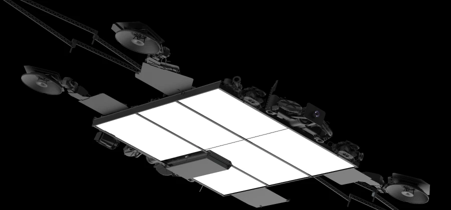
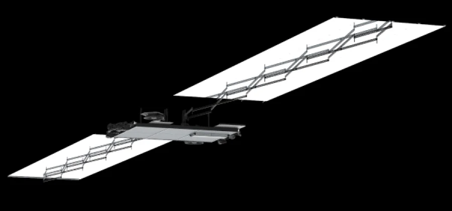
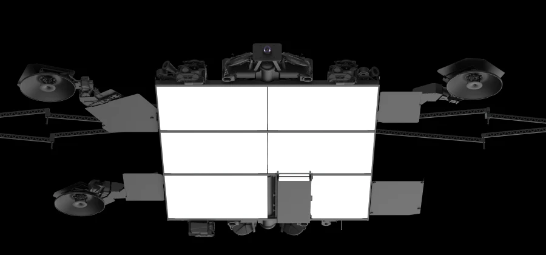
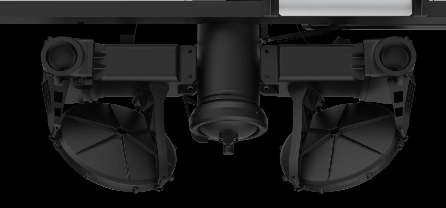
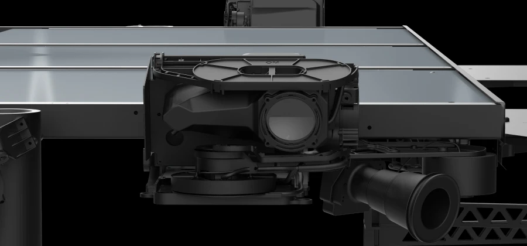
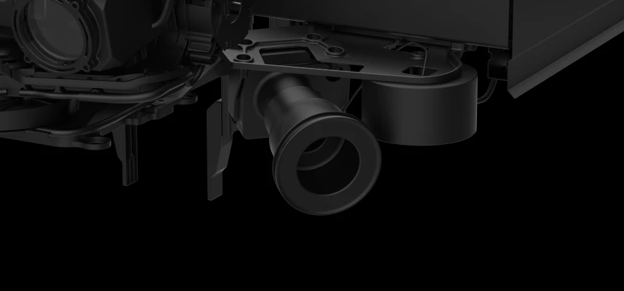
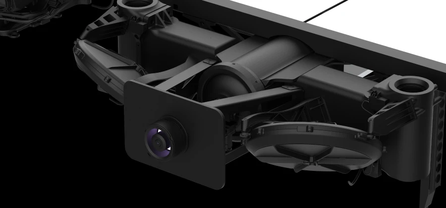
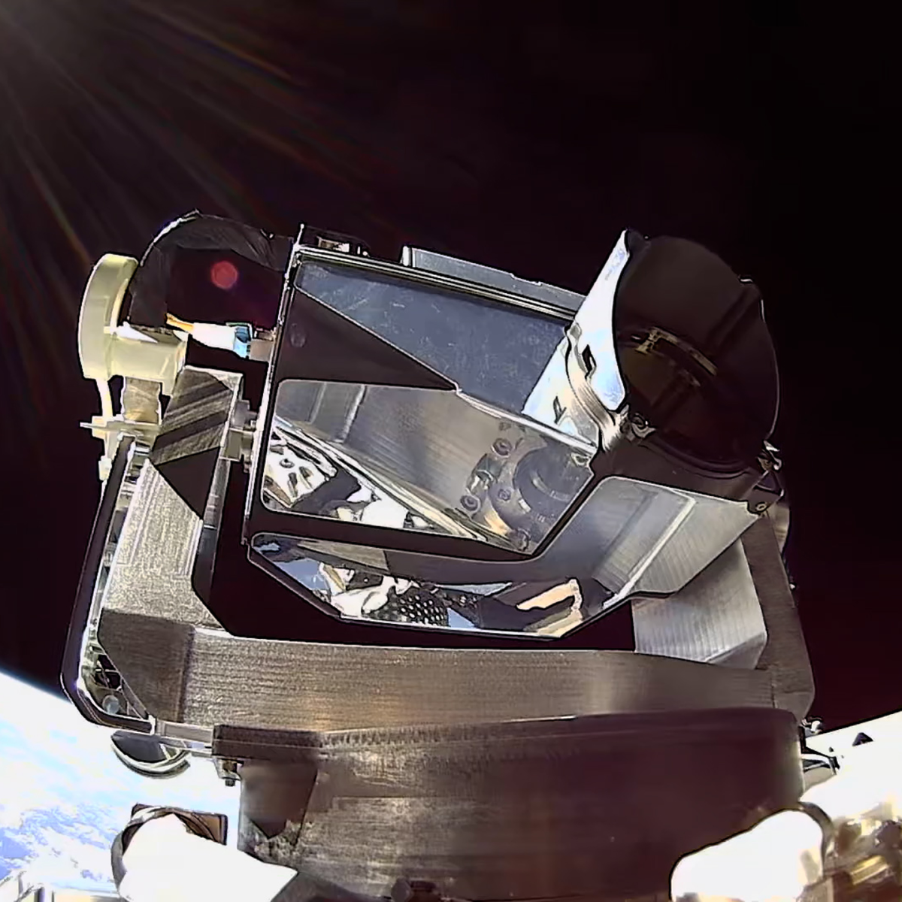

# Starlink PCBs

From conversation with Gemini on [Starlink PCBs](https://share.google/aimode/KffLz0YXrVwn3ZHf8)

> Consider creating a satellite like Starlink (latest generation). List, what types of PCBs would be required for it?

Building a latest-generation LEO broadband satellite like **Starlink V3** requires **six specialized categories of space-grade PCBs** to handle terabit-scale phased-array communications, high-power solar distribution, optical laser links, and autonomous flight control in a vacuum.

[Starlink | Technology](https://starlink.com/technology)

[The Circuit Boards Keeping the New Space Race Alive | by Imran Valiani | Medium](https://medium.com/@SilicontoSoftware5/the-circuit-boards-keeping-the-new-space-race-alive-925aeb108ddd)

[Starlink | Starlink Version 3 Satellites](https://starlink.com/updates/starlink-version-3-satellites)

Because standard commercial FR-4 outgasses volatiles and fails thermally in space, every board relies on specialized substrates (such as polyimide, PTFE, ceramic-filled laminates, and heavy copper) engineered for extreme thermal cycling (-150°C to +150°C+) and radiation tolerance.

[Designing Satellite Payload PCBs for Extreme Temperatures: Material Selection and Layout Techniques](https://www.allpcb.com/allelectrohub/designing-satellite-payload-pcbs-for-extreme-temperatures-material-selection-and-layout-techniques)

[How to Select Materials for Space-Grade PCBs | AdvancedPCB](https://www.advancedpcb.com/en-us/resources/blog/space-grade-pcbs-requirements,-materials,-standards,-and-design-priorities/)

## 1. RF & Microwave Phased-Array PCBs (Payload Antennas)

The primary communications payload uses massive electronically steered phased arrays operating across Ku-, Ka-, E-, V-, and W-bands.

- **Antenna & Beamforming Boards**: Large-format, low-loss RF PCBs made with **PTFE (Teflon) or ceramic-filled hydrocarbon laminates (e.g., Rogers)**. These maintain a stable dielectric constant at microwave/millimeter-wave frequencies (up to 60+ GHz) to prevent signal attenuation.
- **Hybrid Stack-Ups**: Often built as mixed-material multilayer boards combining high-frequency RF layers on the outside with high-temperature polyimide digital/control layers inside.

[Types of PCBs: a complete guide to navigate solutions and applications - Elemaster Group](https://www.elemaster.com/en/types-of-pcbs-a-complete-guide-to-navigate-solutions-and-applications/)

[Types Of PCB Explained: 2025 Ultimate Guide & Selection Tips - FAST TURN PCB](https://www.fastturnpcbs.com/blog/types-of-pcb-explained/)

## 2. High-Density Interconnect (HDI) Digital Compute PCBs

Latest-generation Starlink satellites perform heavy onboard digital beamforming, packet routing, and edge compute using custom modem ASICs and space-qualified adaptive SoCs (such as AMD Versal AI Core).

[SpaceX Unveils 250 kW Starlink Gen3 AI Satellites Featuring 10 Tbps Throughput and Onboard Edge Compute – SatNews](https://satnews.com/2026/10/04/spacex-unveils-250-kw-starlink-gen3-ai-satellites-featuring-10-tbps-throughput-and-onboard-edge-compute/)

[Satellite PCB: How Electronics Survive Space Radiation](https://www.silicontosoftware.com/satellite-pcb-space-radiation/)

[Starship 11 – A Step Towards a New Era of Starlink v3](https://www.skylinker.io/p/starship-11-a-step-towards-a-new-era-of-starlink-v3-eng)

- **High-Layer-Count HDI Boards**: 16-to-32+ layer polyimide boards featuring blind/buried microvias, via-in-pad technology, and strict impedance control.

  [The Role of PCBs in Satellite Communications | Sellectronics](https://www.sellectronics.co.uk/blog/the-role-of-pcbs-in-satellite-communications/)

- **Function**: Connects high-pin-count BGA processors, high-speed DDR memory, and SERDES interfaces routing multi-terabit data streams between the RF arrays and optical terminals.

## 3. Heavy-Copper & Metal-Core Power Distribution PCBs (EPS)

With next-generation satellites scaling solar arrays and payload power dramatically, the Electrical Power System (EPS) must manage high currents and intense heat without convective cooling.

- **Heavy-Copper PCBs**: Multilayer boards with thick copper planes (2 oz to 10+ oz / up to 400 µm) to handle high-current solar array regulation, battery management (BMS), and step-down DC-DC conversion with minimal resistive loss.
- **Metal-Core / Ceramic Substrates**: Aluminum-backed or aluminum nitride (AlN) ceramic PCBs used for high-power RF amplifiers and power converters to conduct heat directly into the satellite's structural radiator chassis.

## 4. High-Speed Electro-Optical & Laser Terminal PCBs

Modern Starlink satellites use multiple 200–400 Gbps optical inter-satellite links (space lasers) to form an orbital mesh network.

- **Ultra-Low-Loss High-Speed Digital PCBs**: Engineered with ultra-smooth copper foil and low-dissipation-factor laminates to preserve signal integrity for multi-gigabit laser drivers and transimpedance amplifiers.
- **Precision Gimbal & Optics Control Boards**: Mixed-signal PCBs controlling the fine-steering mirrors, photodiodes, and thermal stabilization loops required to keep laser beams locked across thousands of kilometers.

## 5. Radiation-Tolerant Avionics & GNC PCBs

The Guidance, Navigation, and Control (GNC) subsystem keeps the satellite oriented, avoids debris, and manages orbital maneuvers.

[Starlink Satellite Constellation](https://www.eoportal.org/satellite-missions/starlink)

- **Flight Computer & Watchdog Boards**: High-reliability polyimide PCBs designed with triple-modular redundancy (TMR), wide trace spacing to prevent arcing, and radiation-hardened components.

- **Sensor & Actuator Interface Boards**: Dedicated mixed-signal boards interfacing with custom star trackers, GPS receivers, IMUs, and four-axis reaction wheels.

- **Propulsion Power Processing Unit (PPU) Boards**: High-voltage, creepage-isolated PCBs that step up bus voltage to drive the argon-fueled Hall-effect ion thrusters.

  [How To Design Boards And Electronics for Space (with Cedric Corpa)](https://www.youtube.com/watch?v=-q1WWh5CwwU)
  
  [PCB design for space](https://www.youtube.com/watch?v=Kih9GqZhokA&t=45s)
  
  [Satellite PCB Reliability Design Controls | GNS | How to Design Satellite PCB and Space-Grade PCBA for Reliability](https://gnsems.com/how-to-design-satellite-pcb-and-space-grade-pcba-design-for-zero-failure-missions/)
  
  [SpaceX - Satellite Constellation - NewSpace Index](https://www.newspace.im/constellations/spacex-starlink-v2-mini)

## 6. Rigid-Flex & Flexible Harness PCBs

Starlink's flat-panel chassis packs tightly inside rocket fairings and deploys massive solar wings once in orbit.

- **Polyimide Rigid-Flex PCBs**: Combines rigid component-mounting sections with flexible polyimide ribbons to replace bulky wire harnesses, save mass, and survive launch vibration without connector failure.
- **Solar Array & Gimbal Flex Circuits**: Dynamic flex PCBs routed across solar array hinges and deployable structures to carry power and telemetry.

## Summary by Subsystem

| Satellite Subsystem | Primary PCB Type | Key Substrate / Material | Critical Design Requirement |
| :--- | :--- | :--- | :--- |
| **Phased-Array Payload** | RF / Microwave Multilayer | PTFE / Ceramic-filled (Rogers) | Low dielectric loss at Ku/Ka/E/V/W bands |
| **Onboard Compute / Routing** | High-Layer HDI | High-\(T_{g}\) Polyimide | Microvias, impedance control, BGA density |
| **Power & Propulsion (EPS/PPU)** | Heavy Copper & Metal-Core | Polyimide + Thick Cu / AlN Ceramic | High-current capacity, thermal conduction, high-voltage isolation |
| **Optical Laser Links (ISL)** | Ultra-High-Speed Mixed-Signal | Low-loss Polyimide / Hydrocarbon | 200–400 Gbps signal integrity, precision mirror servo control |
| **Avionics & Star Trackers** | Space-Grade Rigid Multilayer | Polyimide (NASA ASTM E595 low-outgassing) | Radiation tolerance, redundancy, optical cleanliness |
| **Interconnects & Solar Wings** | Rigid-Flex & Dynamic Flex | Kapton Polyimide | Vibration resistance, mass reduction, hinge flexibility |

Are you focusing on a specific aspect—such as 
- **RF phased-array stack-ups**, 
- **space-grade manufacturing standards (IPC-6012DS / NASA outgassing)**, 
- or **component selection for a CubeSat/SmallSat prototype**? 

Let me know and I can dive into the technical design rules for that area.
