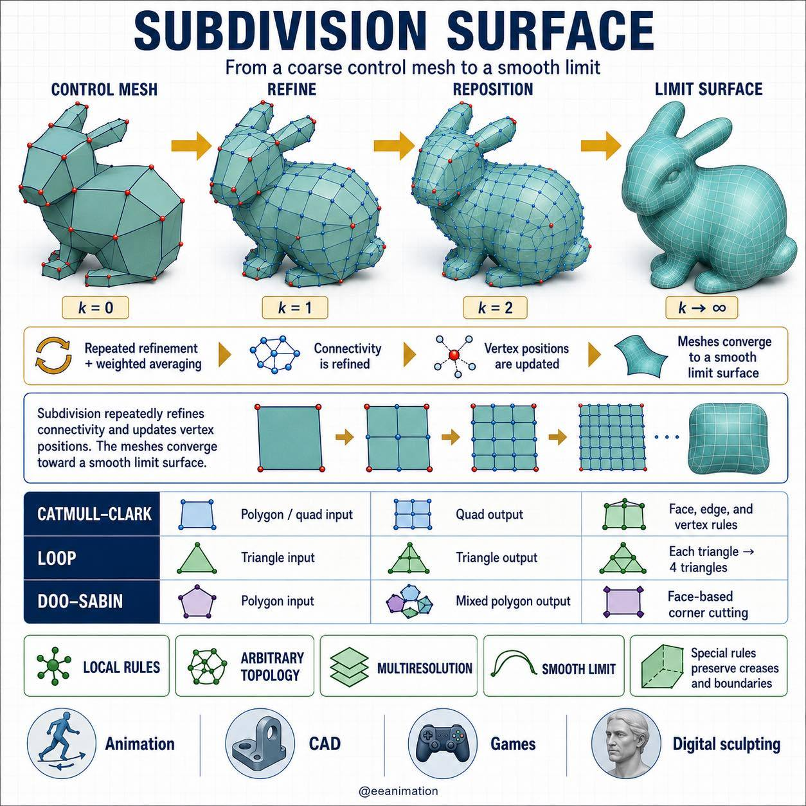

# Subdivision surfaces

- [Subdivision surface (Wikipedia)](https://en.wikipedia.org/wiki/Subdivision_surface)

---

[eeanimation's post on subdivision surface](https://www.instagram.com/p/DcWCWAymW5Q/):

A subdivision surface transforms a coarse polygonal control mesh into a smooth mathematical surface. 🐇

Each iteration performs two essential operations:

* Refines the mesh connectivity by creating smaller faces.
* Repositions vertices using local weighted averages.

The increasingly dense meshes converge toward a smooth limit surface. Popular schemes include Catmull–Clark for polygon and quad meshes, Loop for triangular meshes, and Doo–Sabin for face-based corner cutting.

Subdivision surfaces are widely used in animation, games, CAD, and digital sculpting because complex smooth forms can be controlled with relatively simple meshes.

#SubdivisionSurface #ComputerGraphics #3DModeling #GeometryProcessing #CatmullClark #LoopSubdivision #DooSabin #CAD #eeanimation

